<p align="center">
  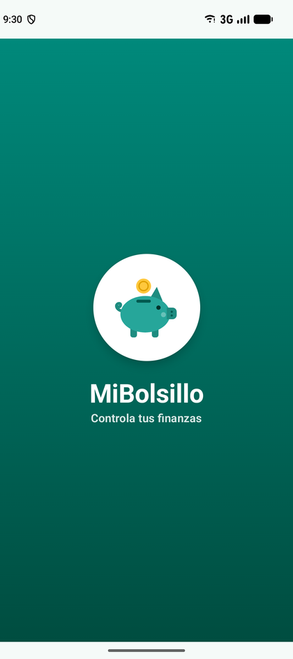
</p>

<h1 align="center">MiBolsillo – Controla tus finanzas</h1>

<p align="center">
  App Android de finanzas personales para estudiantes y jóvenes.<br>
  Registra ingresos y gastos, controla presupuestos, crea metas de ahorro y visualiza tus finanzas con gráficas.
</p>

<p align="center">
  
  
  
  
</p>

---

**Proyecto de la asignatura:** Laboratorio de Programación para Dispositivos Móviles.

Toda la información se guarda **localmente en el teléfono** (Room + DataStore): no hay servidor, ni cuentas en la nube, ni APIs externas.

## Índice

- [Funcionalidades](#funcionalidades)
- [Capturas](#capturas)
- [Tecnologías](#tecnologías)
- [Arquitectura (MVVM)](#arquitectura-mvvm)
- [Estructura del proyecto](#estructura-del-proyecto)
- [Base de datos](#base-de-datos)
- [Navegación](#navegación)
- [Instalación](#instalación)
- [Generar el APK](#generar-el-apk)
- [Pruebas](#pruebas)
- [Equipo](#equipo)

## Funcionalidades

| Pantalla | Qué hace |
|---|---|
| **Splash** | Logo animado (alcancía). Si hay sesión guardada va a Inicio; si no, a Login. |
| **Login / Registro** | Validación de campos vacíos, formato de correo, contraseña de mínimo 6 caracteres y confirmación. El correo no se puede repetir. La contraseña se guarda como **hash SHA-256** (nunca en texto plano). |
| **Inicio** | Saludo, saldo actual, ingresos y gastos del mes, **alertas de presupuesto**, consejo del día, gráfica de gastos por categoría y últimos 5 movimientos. |
| **Movimientos** | Lista agrupada por día, **búsqueda**, filtros por **tipo**, **categoría** y **mes**. Agregar, editar y eliminar (con confirmación). |
| **Estadísticas** | Indicadores (tasa de ahorro, variación vs. mes anterior, gasto promedio, mayor gasto), **gráfica de pastel** por categoría y **gráfica de barras** ingresos vs. gastos de 6 meses (táctil). Dibujadas con **Canvas** de Compose. |
| **Presupuestos** | Límite mensual por categoría con barra **verde / amarilla / roja** y avisos al **80%** y al **100%**. Copiar presupuestos del mes anterior. |
| **Metas de ahorro** | Meta con nombre, monto, fecha límite e icono. Registrar aportes, progreso, sugerencia de ahorro semanal y **felicitación con confeti** al completarla. |
| **Consejos** | 20 consejos reales de ahorro y educación financiera, filtrables por tema. |
| **Perfil** | Datos del usuario, cambiar **moneda** (RD$ por defecto), tema **claro / oscuro / sistema**, datos de demostración y cerrar sesión. |

Otros detalles:

- Formato de moneda con separador de miles: `RD$ 1,250.00`.
- Estados vacíos en todas las listas ("Aún no tienes movimientos").
- La UI se actualiza sola gracias a `Flow`: al agregar un gasto cambian Inicio, Estadísticas y Presupuestos sin recargar.
- Cada usuario solo ve sus propios datos (todas las consultas filtran por `usuarioId`).
- Logo e iconos en formato vectorial (VectorDrawable), nítidos en cualquier pantalla.
- **Datos de demostración** (Perfil): en una cuenta nueva cargan 6 meses de movimientos, presupuestos y metas para presentar la app.

## Capturas

| Splash | Login | Inicio | Inicio (abajo) |
|:---:|:---:|:---:|:---:|
|  | 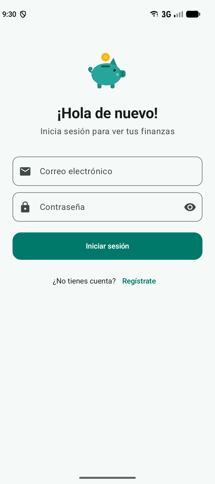 | 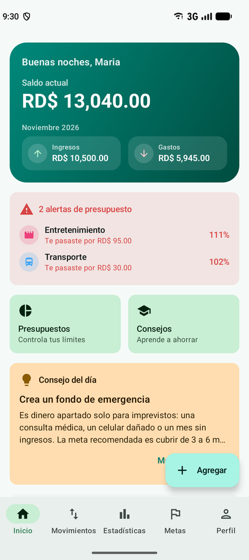 | 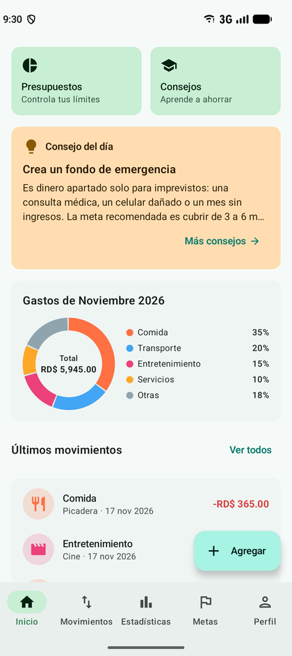 |

| Movimientos | Nuevo movimiento | Estadísticas | Ingresos vs gastos |
|:---:|:---:|:---:|:---:|
| 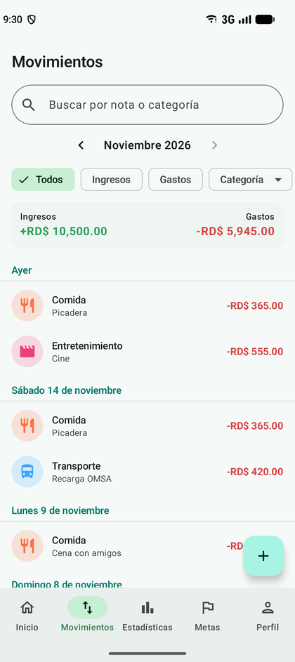 | 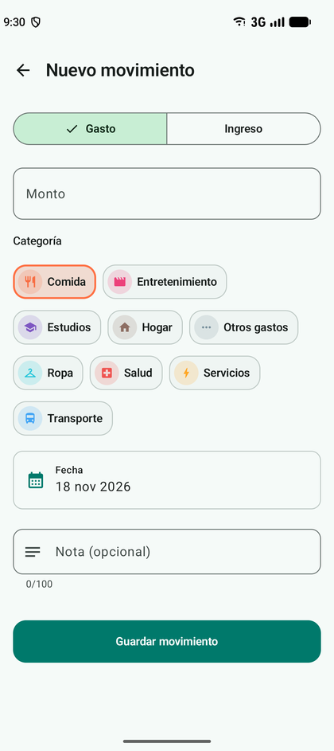 | 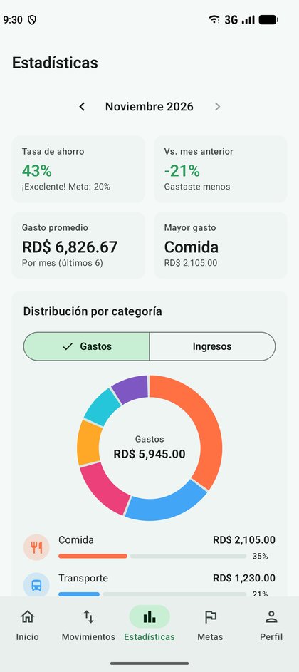 | 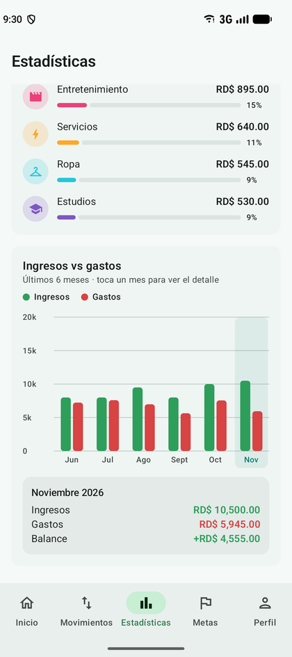 |

| Metas | Presupuestos | Consejos | Perfil |
|:---:|:---:|:---:|:---:|
| 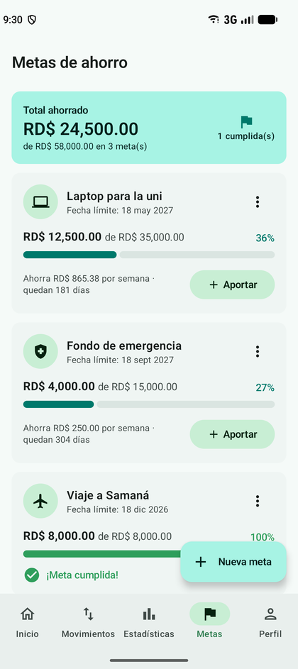 | 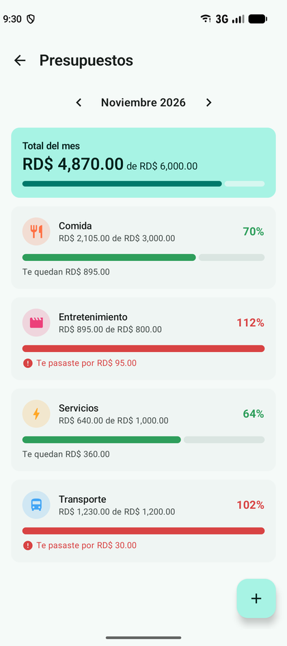 | 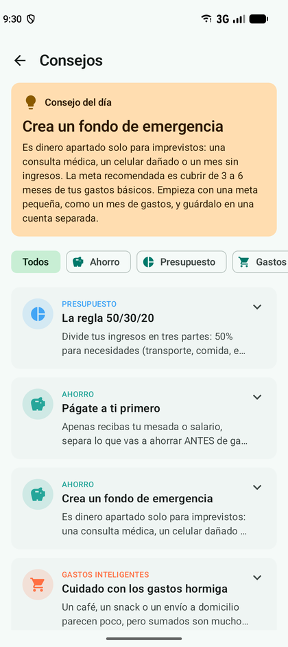 | 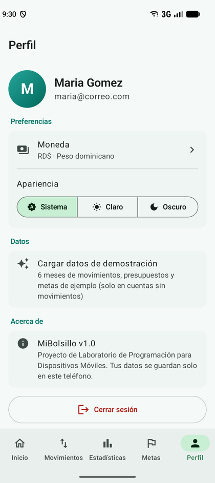 |

| Modo oscuro: Inicio | Modo oscuro: Estadísticas |
|:---:|:---:|
| 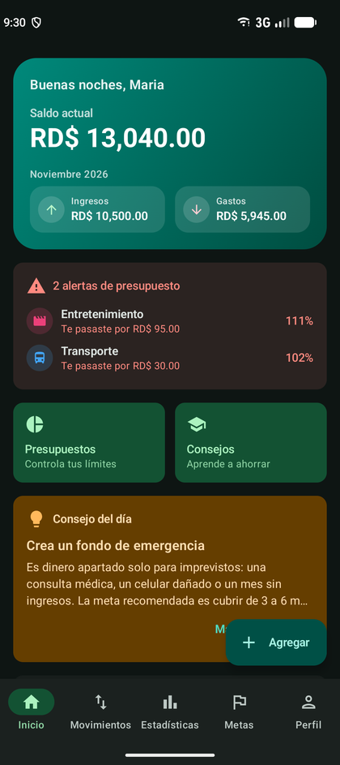 | 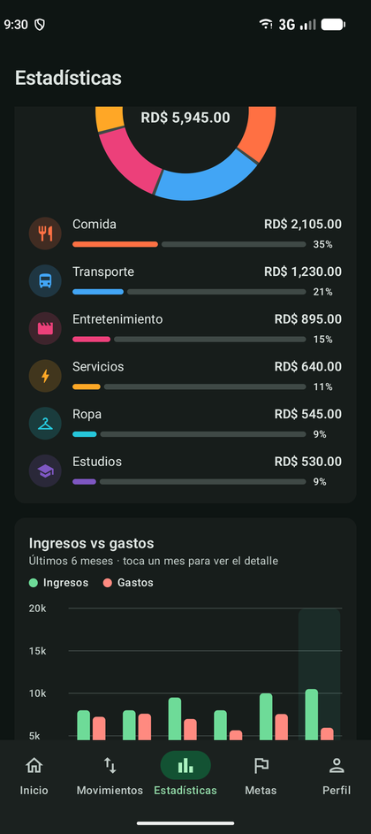 |

## Tecnologías

| Área | Tecnología |
|---|---|
| Lenguaje | Kotlin |
| UI | Jetpack Compose + Material Design 3 (paleta verde/turquesa propia, modo oscuro) |
| Base de datos | Room (SQLite) con KSP |
| Preferencias y sesión | DataStore Preferences |
| Navegación | Navigation Compose |
| Arquitectura | MVVM (ViewModel + StateFlow/Flow + Repositorios) |
| Asincronía | Corrutinas de Kotlin |
| Gráficas | Canvas de Compose (sin librerías externas) |
| Build | Gradle (Kotlin DSL) con catálogo de versiones, R8 en release |

Requisitos: **Android 8.0 (API 26)** o superior.

## Arquitectura (MVVM)

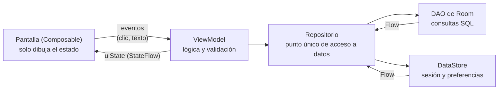

- **Composable (UI):** dibuja el estado y avisa de eventos. No contiene lógica de negocio.
- **ViewModel:** valida formularios, combina datos (`combine`, `flatMapLatest`) y expone un `uiState`. Sobrevive a la rotación de pantalla.
- **Repositorio:** decide de dónde salen los datos (Room o DataStore).
- **DAO:** consultas SQL que devuelven `Flow`, por eso la UI se actualiza sola.
- **Inyección de dependencias manual:** `MiBolsilloApplication` crea la base de datos y los repositorios; `AppViewModelProvider` construye los ViewModels.

## Estructura del proyecto

```
app/src/main/java/com/example/mibolsillo/
├── MiBolsilloApplication.kt     # Contenedor de dependencias (BD y repositorios)
├── MainActivity.kt              # Única Activity; aplica tema y moneda
├── data/
│   ├── local/
│   │   ├── AppDatabase.kt       # Base de datos Room + categorías precargadas
│   │   ├── entity/              # Tablas: Usuario, Categoria, Movimiento, Presupuesto, MetaAhorro
│   │   ├── dao/                 # Consultas SQL de cada tabla
│   │   └── model/               # Resultados de consultas con JOIN / GROUP BY
│   ├── preferencias/            # DataStore: sesión, moneda, tema
│   ├── repository/              # Repositorios (Usuario, Movimiento, Presupuesto, Meta, Categoria)
│   ├── consejos/                # Contenido educativo (20 consejos)
│   └── demo/                    # Generador de datos de demostración
├── ui/
│   ├── theme/                   # Colores, tipografía y tema claro/oscuro
│   ├── navigation/              # Rutas y NavHost
│   ├── components/              # Componentes reutilizables y gráficas (Canvas)
│   ├── splash/  auth/  inicio/  movimientos/  estadisticas/
│   └── presupuestos/  metas/  consejos/  perfil/
└── util/                        # Hash SHA-256, validaciones, formato de moneda y fechas
```

## Base de datos

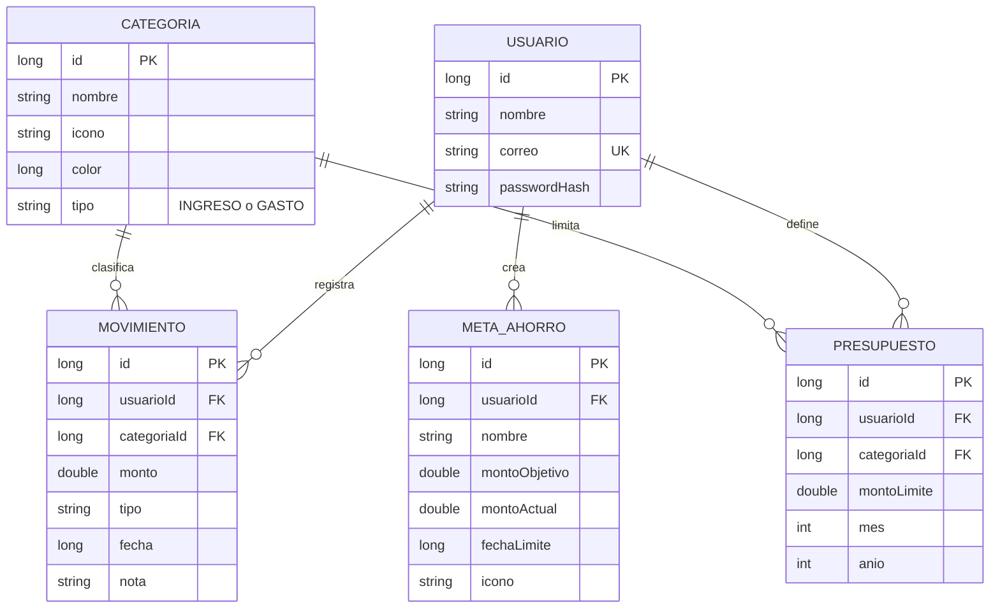

- Al crear la base de datos se precargan **15 categorías**: 9 de gasto (Comida, Transporte, Estudios, Entretenimiento, Salud, Hogar, Ropa, Servicios, Otros) y 6 de ingreso (Salario, Mesada, Beca, Ventas/Freelance, Regalos, Otros).
- Claves foráneas con `CASCADE`: si se elimina un usuario, se eliminan sus datos.
- Índices únicos: el correo del usuario, y un presupuesto por categoría y mes.

## Navegación

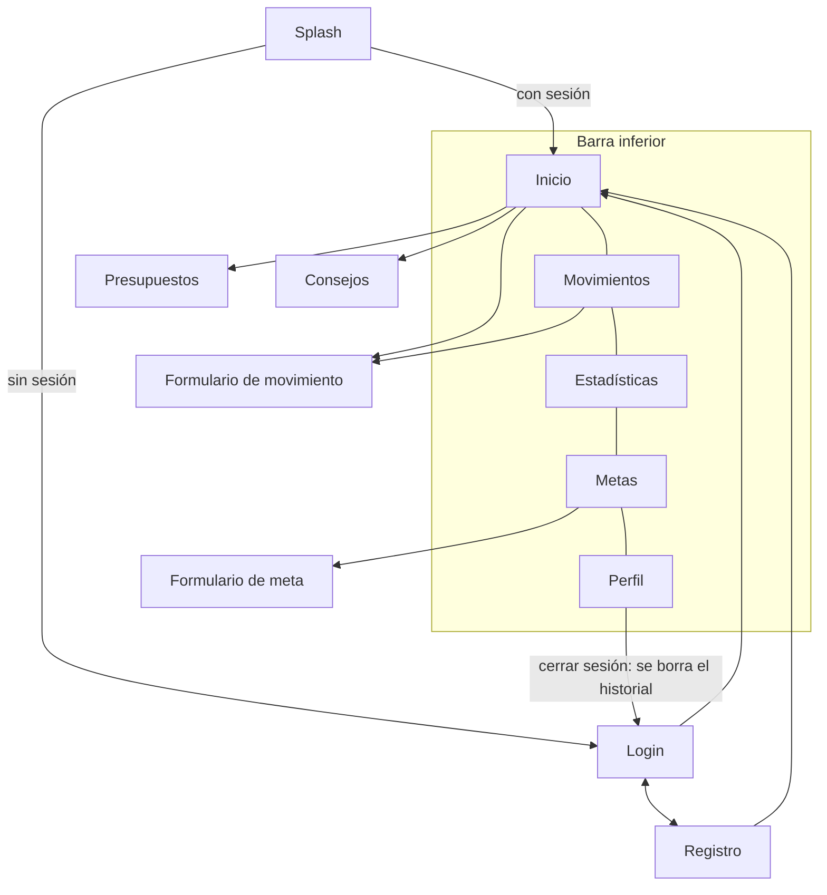

## Instalación

### Opción A: instalar el APK en un teléfono

1. Descarga `MiBolsillo-v1.0.apk` desde [Releases](https://github.com/Gilx03/mibolsillo/releases).
2. En el teléfono, abre el archivo y permite "Instalar apps de origen desconocido" si te lo pide.
3. Abre **MiBolsillo**, crea una cuenta y listo.
4. (Opcional) En **Perfil → Cargar datos de demostración** verás la app con datos de ejemplo.

### Opción B: compilar con Android Studio

1. Instala **Android Studio** (versión reciente, con el SDK de Android 37).
2. Clona el repositorio:
   ```bash
   git clone https://github.com/Gilx03/mibolsillo.git
   ```
3. Abre la carpeta del proyecto en Android Studio y espera a que termine la sincronización de Gradle.
4. Conecta un teléfono (con depuración USB) o inicia un emulador y presiona **Run ▶**.

## Generar el APK

**Desde Android Studio:** menú **Build → Generate Signed App Bundle / APK… → APK**, elige o crea tu llave (`.jks`) y la variante **release**.

**Desde la terminal:**

1. Crea una llave de firma (solo la primera vez):
   ```bash
   keytool -genkeypair -v -keystore mibolsillo-release.jks -alias mibolsillo -keyalg RSA -keysize 2048 -validity 10000
   ```
2. Crea el archivo `keystore.properties` en la raíz del proyecto:
   ```properties
   storeFile=mibolsillo-release.jks
   storePassword=TU_CONTRASEÑA
   keyAlias=mibolsillo
   keyPassword=TU_CONTRASEÑA
   ```
3. Compila:
   ```bash
   ./gradlew assembleRelease        # Windows: gradlew.bat assembleRelease
   ```
4. El APK queda en `app/build/outputs/apk/release/app-release.apk` (≈ 2 MB gracias a R8).

> 🔒 `keystore.properties` y los archivos `.jks` están en `.gitignore`: **nunca se suben al repositorio**. Si no existe `keystore.properties`, el APK de release se firma con la llave de depuración para que cualquier integrante pueda compilarlo y probarlo.

## Pruebas

Pruebas unitarias de la lógica sin Android (validaciones, hash, formato de moneda y escala de gráficas):

```bash
./gradlew testDebugUnitTest
```

Archivo: `app/src/test/java/com/example/mibolsillo/UtilidadesTest.kt`.

## Equipo

| Integrante | Matrícula | Responsabilidad |
|---|---|---|
| _Gilberto Gonzalez_ | _2021-1005_ | Desarrollo completo de la app |

---

